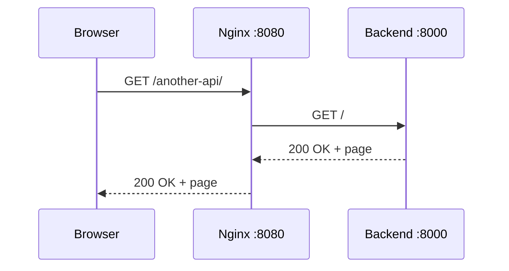
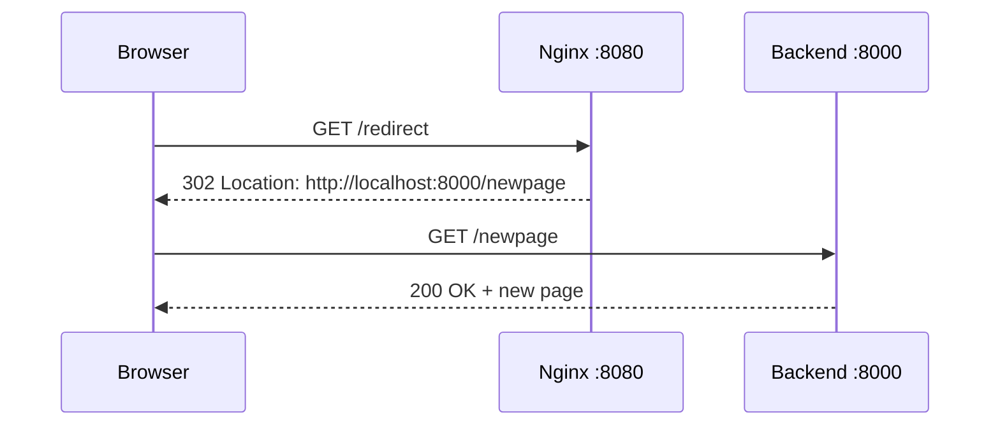

Nginx can send traffic to another service without changing the URL in the browser. This is different from an HTTP redirect, where the browser is told to visit another URL.<!-- truncate_here -->

Suppose a portal runs through Nginx at `localhost:8080`, while another service runs at `localhost:8000`.

We want the following portal URL:

```text
http://localhost:8080/another-api/
```

to return the index page from the service running on port `8000`.

There are two ways this can appear to work: proxying and redirecting. They produce a page in the browser, but the network flow is not the same.

## Nginx as a reverse proxy

Nginx is a reverse proxy. It can receive a request, forward that request to another service, and return the service's response to the browser.



The browser communicates only with Nginx. It does not open a connection to port `8000`, so its address bar remains:

```text
http://localhost:8080/another-api/
```

Here is the Nginx configuration:

```nginx
upstream backend {
    server 127.0.0.1:8000;
}

server {
    listen 8080;

    location ~ ^/another-api/?$ {
        rewrite ^/another-api/?$ / break;
        proxy_pass http://backend;
    }
}
```

The location accepts both `/another-api` and `/another-api/`.

The `rewrite` changes the URI internally from `/another-api` or `/another-api/` to `/`. The `break` flag stops rewrite processing in the current location. It does not send a redirect to the browser.

This detail is useful when the backend serves its index page at `/`. Without the rewrite, the backend would receive `/another-api/`, which it may not recognize. Rewriting both forms to `/` also prevents the backend from having to redirect the bare path just to add a trailing slash.

The `proxy_pass` directive has no URI suffix:

```nginx
proxy_pass http://backend;
```

This matters because the location is defined with a regular expression. Nginx does not allow a URI part in `proxy_pass` inside a regex location. For example, do not write:

```nginx
# Invalid inside this regex location
proxy_pass http://backend/;
```

Instead, rewrite the URI first and use `proxy_pass` without the trailing slash. After the rewrite, the upstream service receives `/`.

If we removed the rewrite, a `proxy_pass` without a URI suffix would forward the complete original URI, including `/another-api/`.

## An HTTP redirect

A redirect works differently. The server returns a `Location` header and asks the browser to make another request.

For example:

```nginx
location = /redirect {
    return 302 http://localhost:8000/newpage;
}
```

The flow now looks like this:



After the `302` response, Nginx is no longer in the middle. The browser connects directly to the service on port `8000`, and its address bar changes to:

```text
http://localhost:8000/newpage
```

In this local example, the hostname remains `localhost`, but the port changes. If the `Location` header points to a different hostname, the domain in the browser changes too.

You can see the redirect without a browser by inspecting the response headers:

```bash
curl -i http://localhost:8080/redirect
```

The response includes something similar to:

```http
HTTP/1.1 302 Moved Temporarily
Location: http://localhost:8000/newpage
```

Using `curl -L` follows the redirect and makes the second request:

```bash
curl -iL http://localhost:8080/redirect
```

## Why the port number matters

An IP address identifies a machine on a network. A port number helps the operating system deliver incoming TCP connections to the correct process on that machine.

Both services in this example use the same machine and the same IP address, but they listen on different ports:

| Address | Process |
| --- | --- |
| `localhost:8080` | Nginx |
| `localhost:8000` | Backend service |

The combination of scheme, hostname, and port forms the origin. Therefore, `http://localhost:8080` and `http://localhost:8000` are different origins even though both use `localhost`.

## Proxy or redirect?

Use `proxy_pass` when the browser should remain on the portal URL and Nginx should communicate with the backend on its behalf.

Use a redirect when the browser should know about the destination and make a new request to it.

The easiest way to remember the difference is:

- With a proxy, Nginx follows the route to the backend.
- With a redirect, the browser follows the route to the new URL.
