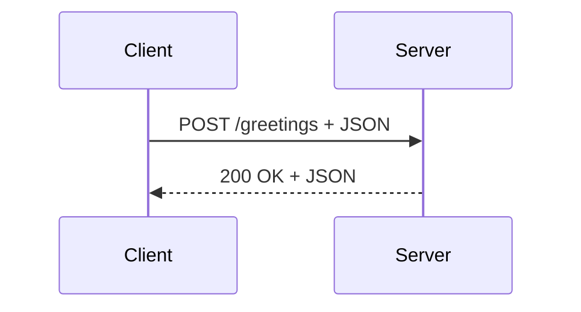
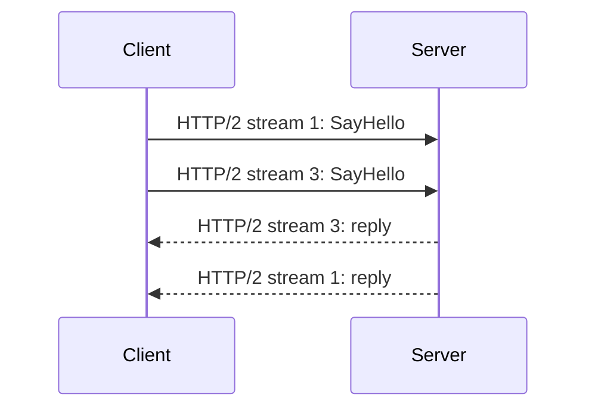

---

A REST API exposes resources. A gRPC API exposes methods. That difference changes how we define the API, generate client code, serialize messages, and stream data between services.<!-- truncate_here -->


A REST API exposes resources. A gRPC API exposes methods. That difference changes how we define the API, generate client code, serialize messages, and stream data between services.

Suppose we want to build an API that greets a user. In REST, we might model the greeting as a resource and access it through an HTTP endpoint:

```http
POST /greetings HTTP/1.1
Content-Type: application/json

{
  "name": "Tushar"
}
```

In gRPC, we model the same operation as a remote method:

```text
Greeter.SayHello(name: "Tushar")
```

The result can be the same, but the programming model is different.

## REST exposes resources

REST organizes an API around resources, which are usually nouns such as `users`, `orders`, or `greetings`. Standard HTTP methods describe what we want to do with those resources:

| HTTP method | Typical meaning | Example |
| --- | --- | --- |
| `GET` | Read a resource | `GET /users/42` |
| `POST` | Create a resource or start an operation | `POST /users` |
| `PUT` | Replace a resource | `PUT /users/42` |
| `PATCH` | Partially update a resource | `PATCH /users/42` |
| `DELETE` | Delete a resource | `DELETE /users/42` |

The client knows the URL, HTTP method, headers, and expected representation. JSON is common, although REST does not require it.

An OpenAPI document can describe this contract, but REST itself does not require one. A team can build a REST endpoint first and document it later. That flexibility is convenient, but it can also allow the implementation and documentation to drift apart.

In a typical Spring Boot REST application, Jackson converts between JSON and Java objects. The controller receives a deserialized object and returns another object that Jackson serializes into JSON.



## gRPC exposes methods

RPC stands for Remote Procedure Call. It lets a client invoke a method on another process using code that resembles a local method call.

The method is not actually local. It can still fail because of a timeout, an unavailable server, authentication, or a network problem. The generated stub hides the networking mechanics, not the realities of distributed systems.

With gRPC, the API contract is normally defined first in a Protocol Buffers file. Here is a small `greeter.proto`:

```protobuf
syntax = "proto3";

package greeting;

option java_package = "com.example.greeting";
option java_multiple_files = true;

service Greeter {
  rpc SayHello (HelloRequest) returns (HelloReply) {}
}

message HelloRequest {
  string name = 1;
}

message HelloReply {
  string message = 1;
}
```

The build invokes the Protocol Buffers compiler and the gRPC plugin. For Java, they generate:

- message classes such as `HelloRequest` and `HelloReply`
- a server base class named `GreeterGrpc.GreeterImplBase`
- client stubs for calling the service
- code for Protocol Buffers serialization and deserialization

This answers a common question: what is `GreeterGrpc.GreeterImplBase`?

It is a generated abstract base class for the server. Our application extends it and overrides the RPC methods it wants to implement. We do not write this class ourselves.

## A gRPC server with Spring Boot 4.1

Spring Boot 4.1 includes gRPC server and client support. With the gRPC server starter on the classpath, a generated service implementation can be exposed as a Spring bean by annotating it with `@GrpcService`:

```java
import io.grpc.stub.StreamObserver;
import org.springframework.grpc.server.service.GrpcService;

@GrpcService
public class GreeterService extends GreeterGrpc.GreeterImplBase {

  @Override
  public void sayHello(
      HelloRequest request,
      StreamObserver<HelloReply> responseObserver) {

    HelloReply reply = HelloReply.newBuilder()
        .setMessage("Hello, " + request.getName() + "!")
        .build();

    responseObserver.onNext(reply);
    responseObserver.onCompleted();
  }
}
```

`@GrpcService` makes the implementation a Spring bean. Because the generated base class implements gRPC's `BindableService`, Spring Boot discovers it and exposes it through the gRPC server. A Netty-based server listens on port `9090` by default.

The `StreamObserver` represents the response stream. This example is a unary RPC, so it sends one reply with `onNext()` and then completes the call with `onCompleted()`.

## Calling the service from a client

The generated client stub handles message serialization, the HTTP/2 transport, and response decoding. A blocking stub makes a unary RPC look similar to a Java method call:

```java
import org.springframework.stereotype.Component;

@Component
public class GreetingClient {

  private final GreeterGrpc.GreeterBlockingStub greeter;

  public GreetingClient(GreeterGrpc.GreeterBlockingStub greeter) {
    this.greeter = greeter;
  }

  public String greet(String name) {
    HelloRequest request = HelloRequest.newBuilder()
        .setName(name)
        .build();

    return greeter.sayHello(request).getMessage();
  }
}
```

Spring Boot can discover generated stubs in the application package and register them as beans. `@ImportGrpcClients` lets us customize the packages or stub types to import when the defaults are not enough.

This client does not need Jackson because the generated Protocol Buffers classes know how to encode and decode their binary representation. However, the code is not free of serialization. That work still happens; it is simply generated from the `.proto` contract instead of being driven by a JSON mapper at runtime.

## HTTP/2, multiplexing, and streaming

gRPC normally runs over HTTP/2. HTTP/2 can carry multiple independent streams over one TCP connection, so concurrent calls do not each require a separate connection.



Multiplexing and bidirectional streaming are related, but they are not the same thing:

- **Multiplexing** means several logical HTTP/2 streams can share one connection.
- **Bidirectional streaming** means the client and server can each send a sequence of application messages during one RPC.

gRPC supports four kinds of method:

| RPC type | Request | Response |
| --- | --- | --- |
| Unary | One message | One message |
| Server streaming | One message | A stream of messages |
| Client streaming | A stream of messages | One message |
| Bidirectional streaming | A stream of messages | A stream of messages |

A REST API is not restricted to HTTP/1.1. It can also use HTTP/2 and benefit from transport-level multiplexing. What gRPC adds is a standard RPC model with generated stubs and explicit streaming method types in the service contract.

WebSocket is another option for full-duplex communication, but it solves a different problem. It provides a persistent, two-way message channel and leaves the application to define its message schema and calling convention. gRPC provides service definitions, typed messages, generated code, status codes, and streaming semantics. Neither is universally "lighter"; the better choice depends on protocol overhead, browser support, infrastructure, and the interaction model.

## Test the service with grpcurl

`grpcurl` is similar to `curl`, but it speaks gRPC. On macOS, install it with Homebrew:

```bash
brew install grpcurl
```

List the services exposed by a local server:

```bash
grpcurl -plaintext localhost:9090 list
```

Call the `SayHello` method:

```bash
grpcurl \
  -plaintext \
  -d '{"name":"Tushar"}' \
  localhost:9090 \
  greeting.Greeter/SayHello
```

The response looks like this:

```json
{
  "message": "Hello, Tushar!"
}
```

`grpcurl` usually discovers services through gRPC server reflection. If reflection is disabled, provide the `.proto` file or a compiled descriptor set explicitly.

## REST or gRPC?

| Concern | REST | gRPC |
| --- | --- | --- |
| API model | Resources and HTTP methods | Services and RPC methods |
| Contract | Optional; commonly OpenAPI | Required `.proto` definition |
| Common payload | JSON text | Protocol Buffers binary |
| Client code | Often handwritten or optionally generated | Normally generated stubs |
| Browser access | Native and straightforward | Usually needs gRPC-Web or a gateway |
| Streaming | Possible, but depends on the chosen technology | Built into the service model |
| Human readability | JSON is easy to inspect | Binary payload needs tooling |

REST is often a natural choice for public APIs, browser clients, and resource-oriented operations. Its HTTP semantics are widely understood, and JSON is easy to inspect.

gRPC is often a strong choice for internal service-to-service calls, strongly typed polyglot systems, low-overhead binary messages, and streaming workflows. The `.proto` file keeps the client and server anchored to the same contract.

The simplest mental model is: REST asks a server to operate on a resource; gRPC asks a server to execute a defined method.

## Further reading

- [Spring Boot gRPC reference](https://docs.spring.io/spring-boot/reference/io/grpc.html)
- [gRPC Java generated-code reference](https://grpc.io/docs/languages/java/generated-code/)
- [gRPC reflection guide](https://grpc.io/docs/guides/reflection/)
